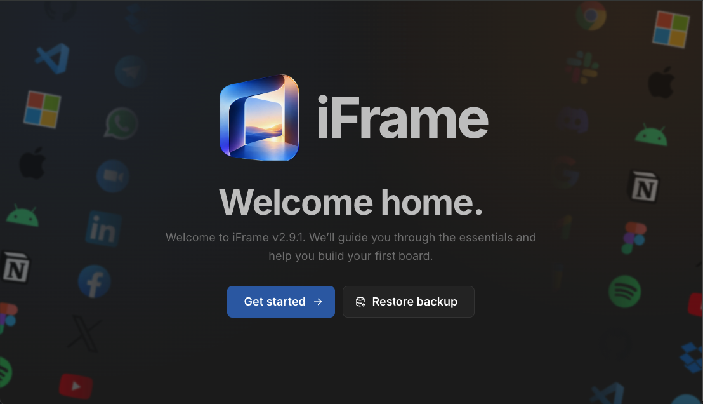
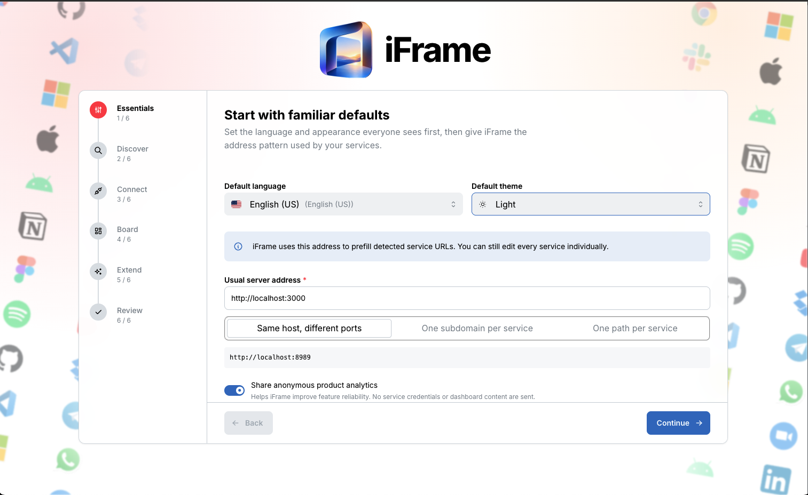
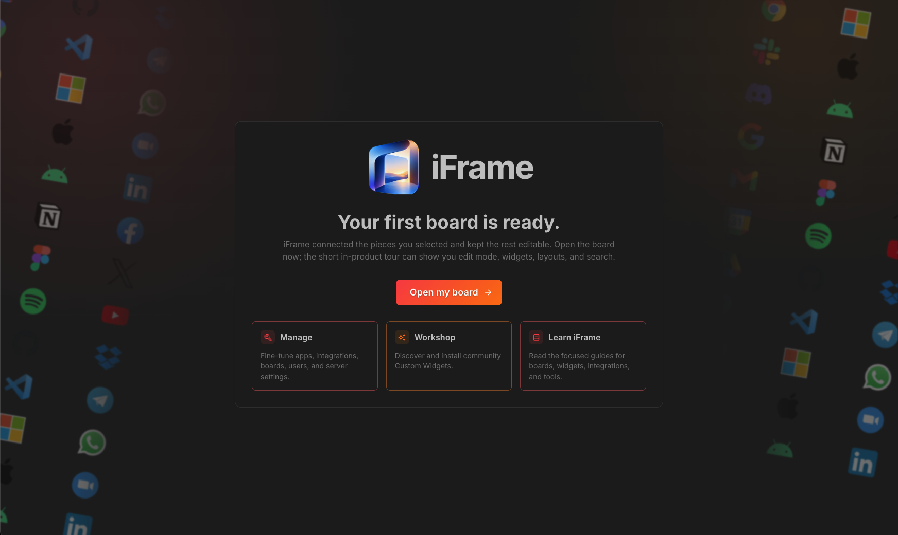
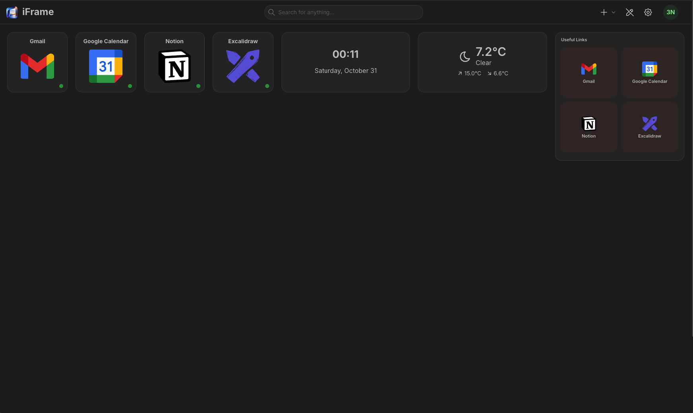

<div align="center">
  
  <h1>iFrame</h1>
  <p>A clean, self-hosted dashboard for embedding the web pages and tools you use — on one drag-and-drop board.</p>
</div>

<p align="center">
  
</p>

---

iFrame is a self-hosted dashboard built around **embeddable “iFrame pages”** and a set of self-contained widgets. Add any site or tool as a tile, drop web pages straight onto the board, and arrange everything into collapsible sections — no accounts, no cloud, your data stays on your server.

It is a rebuild of the excellent [Homarr](https://github.com/homarr-labs/homarr) project (see [Credits](#credits)), reworked into a focused, whitelabel dashboard with a few capabilities of its own.

## Highlights

- **iFrame pages** — embed a web page as a titled, collapsible section on your board.
- **Login support for embedded pages** — an optional per-page reverse proxy serves a site under iFrame’s own origin so its **login session works inside the frame** (browsers normally block this). See [Login support](#login-support).
- **Self-contained widgets** — clock, weather, RSS, a live **sports** ticker, bookmarks, notes, a Discord widget, and more — no external integrations required.
- **Quick-add popular apps** — Telegram, WhatsApp, Slack, Discord and friends are one click to add (they open in a new tab).
- **Multi-user, permissions, light/dark, 30+ languages.**

## Screenshots

| Guided onboarding | Light & dark themes | Ready to go |
| :---: | :---: | :---: |
|  |  |  |

## Quick start (Docker)

You need Docker with the Compose plugin.

```bash
# 1. Get the compose file + env template
curl -O https://raw.githubusercontent.com/3nc0d3d-AWS/iFrame-Dashboard/main/docker-compose.yml
curl -O https://raw.githubusercontent.com/3nc0d3d-AWS/iFrame-Dashboard/main/.env.example
mv .env.example .env

# 2. Set the required secret
echo "SECRET_ENCRYPTION_KEY=$(openssl rand -hex 32)" > .env

# 3. Launch
docker compose up -d
```

Open **http://localhost:7575** and create your admin account.

Everything — the web app, Redis, and database migrations — runs inside the single container. Your data (a SQLite database and uploads) is persisted in the `./iframe-data` volume. The only value you must set is `SECRET_ENCRYPTION_KEY`.

### Build it yourself instead

```bash
git clone https://github.com/3nc0d3d-AWS/iFrame-Dashboard.git
cd iFrame-Dashboard
echo "SECRET_ENCRYPTION_KEY=$(openssl rand -hex 32)" > .env
docker compose up -d --build
```

## Configuration

| Variable | Required | Default | Purpose |
| --- | --- | --- | --- |
| `SECRET_ENCRYPTION_KEY` | **yes** | – | 64-char hex key encrypting stored secrets (`openssl rand -hex 32`). |
| `EMBED_PROXY_ORIGIN` | no | – | Dedicated origin for the iframe login proxy — see below. |

The image also accepts the same database/Redis/auth environment variables as upstream Homarr if you want an external database or SSO; by default it uses a bundled SQLite database and an internal Redis, so nothing else is needed.

## Login support

Many sites won’t log in inside an iframe: the browser treats their session cookie as third-party and drops it. iFrame can route a page through its **own origin** so that cookie becomes first-party and login works.

- Turn it on per page with **“This page needs a login”** when adding an iFrame page (or the **Login support** toggle on an existing iframe widget).
- Single-origin mode works out of the box.
- For stronger isolation in production, serve the proxy from a **dedicated subdomain**: point a second hostname (e.g. `embed.example.com`) at the container, restrict it to the `/api/embed` path, and set `EMBED_PROXY_ORIGIN=https://embed.example.com`.

> Only enable login support for sites you trust — a proxied page runs under iFrame’s own origin. Large providers (Google, Microsoft, banks) actively block proxying; add those as ordinary app tiles (open in a new tab) instead.

## Updating

Pull the newest image and recreate the container — your `./iframe-data` volume is preserved:

```bash
docker compose pull && docker compose up -d
```

## Credits

iFrame is a derivative work of **[Homarr](https://github.com/homarr-labs/homarr)** by the Homarr Labs team and contributors, used under the Apache License 2.0. Enormous thanks to them for the foundation this is built on. iFrame is an independent project and is **not affiliated with or endorsed by Homarr Labs**.

## License

Licensed under the [Apache License 2.0](LICENSE). Changes made in this fork are summarised in [NOTICE](NOTICE).
