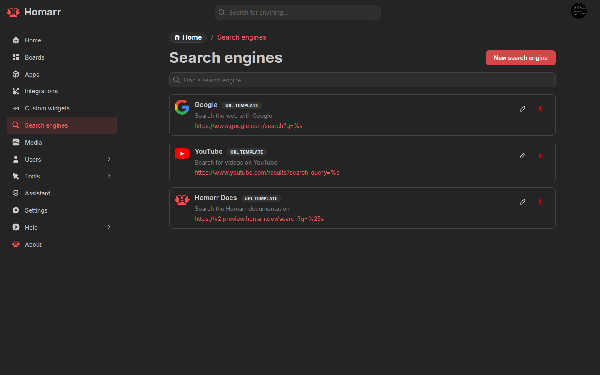
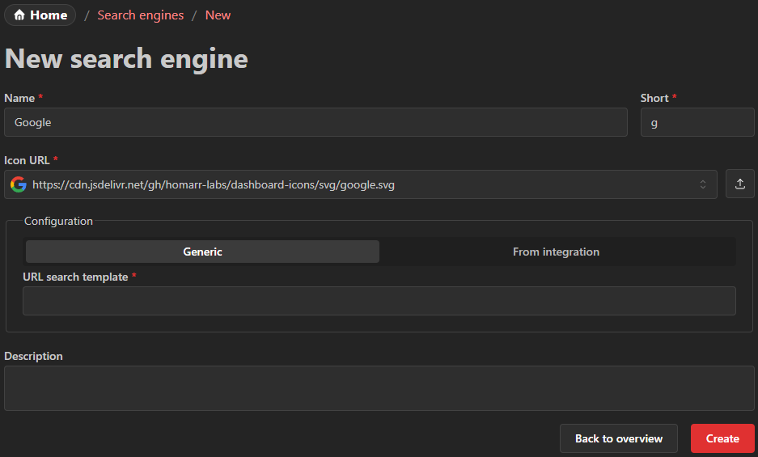

---
tags:
  - Search engines
  - Google
  - Search
---

# Search Engines

Using the search engines, terms can be quickly searched simply by opening the search bar at the top or using the keyboard shortcut `MOD + K`.
The management page provides a searchable list with the shortcut, URL template, source, and available row actions for each engine.

The default **Search** mode lists every configured search engine as a fallback action for the current query. To discover
engines by shortcut, switch to **Web** with `!`. DuckDuckGo bang discovery is intentionally limited to Web mode so an
ordinary search term never expands into similarly named bang providers.

You can add any search engine that has a search URL that accepts a search term as a parameter.

## Create search engine

To create a custom search engine, you can click the button at the top of the page.

### Name

The name can be chosen freely. It will be displayed in the search box popover.

### Short

Prefix that is used to choose the search engine in the popover using the keyboard.
It is recommended that this value is kept short (for example `g` for Google and `e` for Ecosia).
Type `!` in Spotlight to browse these shortcuts and, when DuckDuckGo bangs are enabled in preferences, discover
additional bang providers.

### Configuration

In the configuration section you can select between two options.

#### Search template

The template must be a valid URL that includes the `%s` placeholder.
Homarr will replace the `%s` with the term that the user entered.

##### Examples

- Google: `https://www.google.com/search?q=%s`
- Ecosia: `https://www.ecosia.org/search?q=%s`
- DuckDuckGo: `https://duckduckgo.com/?q=%s`
- Bing: `https://www.bing.com/search?q=%s`
- YouTube: `https://www.youtube.com/results?search_query=%s`

#### From integration

Integration search engines can be configured for [Thingport](../../integrations/thingport), but Spotlight currently does not display their results.

